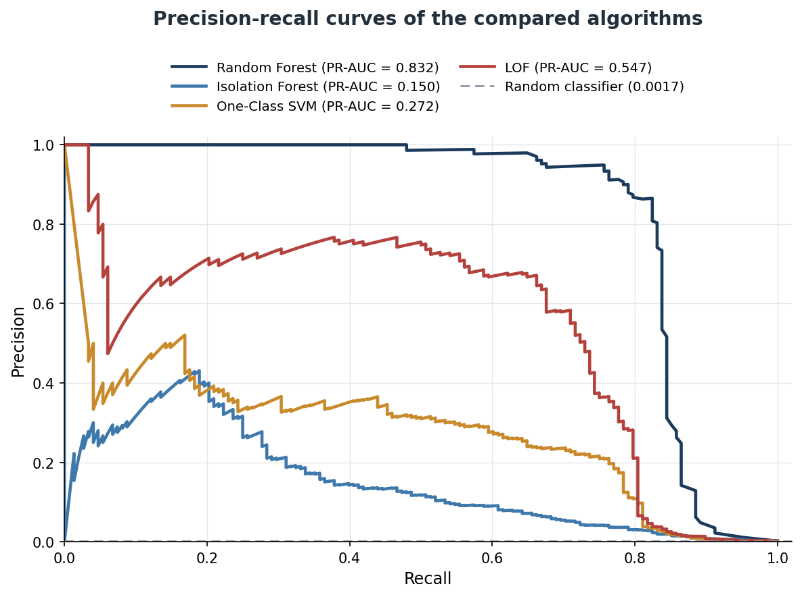

# Anomaly Detection for Payment Fraud

Can unsupervised anomaly detectors, which never see a fraud label during training, catch card fraud as well as a supervised classifier? This repository holds the experiment from my master's thesis, *The role of anomaly detection algorithms in preventing payment fraud in e-commerce* (Business Informatics, Wrocław University of Economics, 2026).

**Short answer:** no. A supervised Random Forest clearly wins when labelled data exists. But the unsupervised models rank transactions far better than their headline precision suggests, which makes them useful as a second layer next to a supervised model.

## Dataset

[Credit Card Fraud Detection](https://www.kaggle.com/datasets/mlg-ulb/creditcardfraud) from Kaggle, published by Worldline and the Machine Learning Group of ULB.

- 284,807 card transactions by European cardholders over two days in September 2013.
- Only 492 are fraud, **0.173%** of all transactions.
- 28 features (V1–V28) are anonymised PCA components; the others are `Time`, `Amount` and the label `Class`.

The dataset isn't included here. Download `creditcard.csv` from Kaggle and put it next to the notebook.

## Method

| Model | Type | Trained on | Tuned |
|---|---|---|---|
| Random Forest | Supervised | Full training set, balanced 1:1 with SMOTE | Baseline: 200 trees, defaults |
| Isolation Forest | Unsupervised | Full training set, labels not used | `contamination` = 0.005 |
| One-Class SVM | Unsupervised (novelty detection) | 25,000 legitimate transactions, standardised | `nu` = 0.005, RBF kernel |
| Local Outlier Factor | Unsupervised (novelty detection) | Same 25,000 legitimate transactions | `n_neighbors` = 50 |

- **Split:** 70% training and 30% test, stratified to keep the fraud rate equal. The test set was never resampled or used for tuning.
- **Tuning:** each unsupervised model's threshold parameter was chosen by F1 on a stratified validation split, 15% of the training set. This uses labels to pick a threshold, so that step is partly supervised.
- **Subsampling:** One-Class SVM and LOF scale poorly with data size, so they were trained on a 25,000-transaction sample to fit Google Colab's limits.
- **Metrics:** precision, recall, F1, ROC-AUC and PR-AUC. Accuracy is left out on purpose: labelling everything "legitimate" would score over 99.8% while catching no fraud at all.

## Results

Test set, 30% of the data:

| Model | Precision | Recall | F1 | ROC-AUC | PR-AUC |
|---|---|---|---|---|---|
| **Random Forest** | **0.880** | 0.791 | **0.833** | **0.967** | **0.832** |
| Isolation Forest | 0.144 | 0.385 | 0.210 | 0.943 | 0.150 |
| One-Class SVM | 0.050 | 0.811 | 0.093 | 0.935 | 0.272 |
| LOF | 0.025 | **0.851** | 0.048 | 0.945 | 0.547 |

False alarms on the test set: **338** for Isolation Forest, **2,304** for One-Class SVM and **4,972** for LOF.




## What the results show

- **Random Forest wins on every metric that matters.** With labels available, a standard supervised model is the strongest option by a wide margin.
- **ROC-AUC hides the difference.** All four models score between 0.935 and 0.967, which looks close. On data this unbalanced, precision and PR-AUC tell the real story: 0.832 PR-AUC for Random Forest against 0.150–0.547 for the unsupervised models.
- **The threshold is part of the problem, not just the model.** LOF's precision-recall curve reaches about 0.76 precision at around 0.4 recall, and it has the best PR-AUC of the unsupervised models (0.547). Yet its chosen threshold sits at 0.851 recall with only 0.025 precision. The model ranks transactions well; the cut-off was a poor fit for 0.17% fraud.
- **Tuning helped Isolation Forest most.** Replacing the default `contamination` raised its precision from 3.65% to 14.43%, and F1 from 0.070 to 0.210. For One-Class SVM and LOF, tuning barely helped: tuning a threshold can't make up for having no labels.
- **Unsupervised models still catch most fraud.** LOF and One-Class SVM found more fraud than Random Forest (0.851 and 0.811 recall against 0.791), just at the cost of many false alarms.

## Conclusion

In this experiment, unsupervised detectors are not a replacement for a supervised classifier. Their value is as a complement: they learn what "normal" looks like without fraud labels, so they can flag unusual transactions that a supervised model, trained only on known fraud, might miss. That points to **hybrid systems**: a supervised model for known fraud patterns, and an anomaly detector flagging unusual cases for review. Whether that catches genuinely new fraud patterns couldn't be tested here, because two days of data can't show how fraud changes over time.

## Limitations

- **Data:** two days of transactions from European cardholders only, with no seasonality or long-term trends.
- **Interpretability:** the features are anonymised PCA components, so it's impossible to tell which real transaction properties drove the decisions.
- **Training sizes differ:** One-Class SVM and LOF were trained on a 25,000-transaction subsample, Random Forest and Isolation Forest on the full training set.
- **Simple tuning:** one parameter per model on a grid of 3–4 values; LOF's `contamination` was left at its default.
- **One split:** a single stratified split, with no cross-validation, so the stability of the numbers isn't measured.
- **Static:** a historical batch experiment, not the real-time streaming setting of production fraud systems.

## Run it

The notebook was written for Google Colab, and also runs locally:

```bash
pip install -r requirements.txt
```

Then put `creditcard.csv` next to `fraud_detection.ipynb` and run all cells. One-Class SVM and LOF take the longest. The notebook saves the results table and the two charts (confusion matrices and precision-recall curves) next to itself.

## Author

**Karol Kołodziejczyk** · Business Informatics MSc, Wrocław University of Economics
[LinkedIn](https://www.linkedin.com/in/karol-kolodziejczyk-pl) · [GitHub](https://github.com/Karol-K02)
